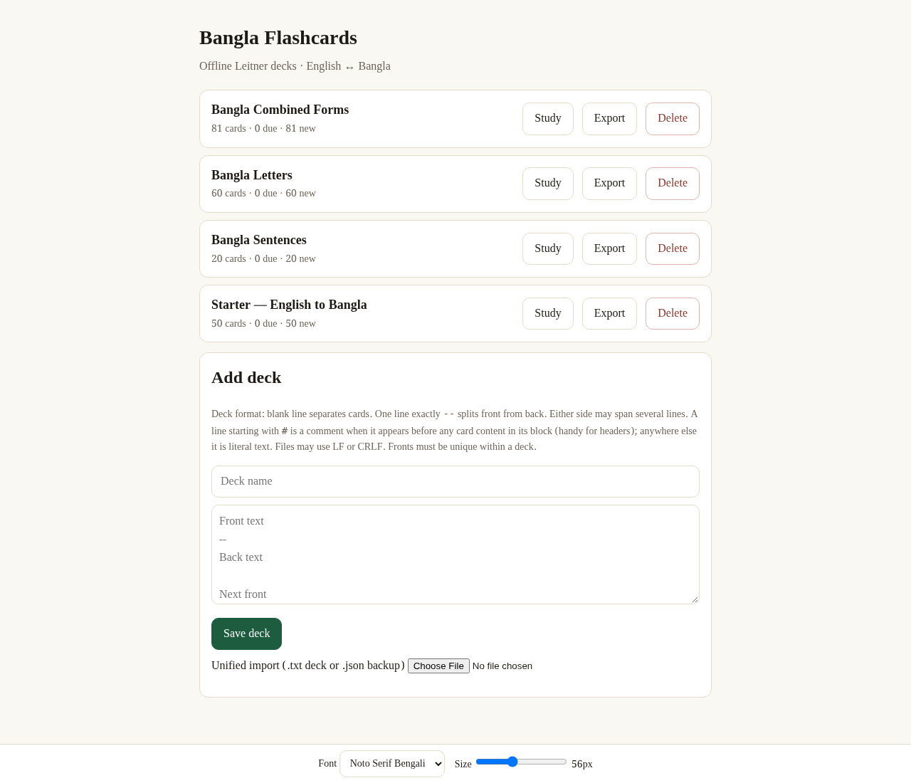
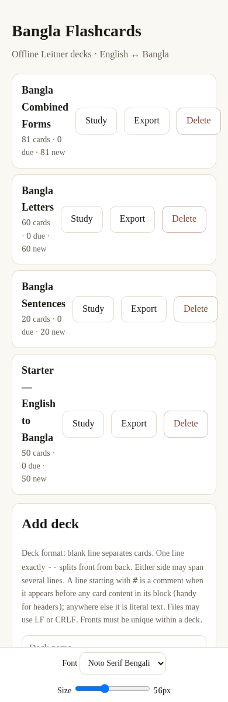

# Bangla Flashcards

[](LICENSE)
[](https://bt108.github.io/bangla-flashcards/)

Offline, single-file Bangla flashcards — Leitner repetition, English ⇄
Bangla. No build, no network, no dependencies. For learners studying
vocabulary, letters, conjuncts, and sentences with daily reviews.

**Live demo:** https://bt108.github.io/bangla-flashcards/
(GitHub Pages, served from this repo)

## 30-second example

Blank line separates cards, `--` splits front from back:

```text
Hello
--
হ্যালো (hyalo)

Thank you
--
ধন্যবাদ (dhonnobad)
```

```sh
python3 -m http.server 8000   # → localhost:8000, Add deck → Study
# …or open index.html directly. State persists in IndexedDB.
```

## Sample output

| Desktop | Mobile |
|---|---|
|  |  |

## Prerequisites

| Tool | Why |
|---|---|
| Modern browser | Runs the app (IndexedDB for decks/state, localStorage for prefs) |
| Python 3 *(optional)* | Local hosting via `http.server`; opening the file works too |
| Bengali font *(optional)* | Card font/size adjustable in the footer bar |

## Commands

No build step. Serve it, or open `index.html` directly:

```sh
python3 -m http.server 8000   # → http://localhost:8000
```

`Space` reveal · `1/2/3` Known/Hard/Unknown · `F` focus · `Esc` quit.

## Project layout

```
index.html   # whole app: CSS + UI + SRS core (window.__flash) + storage
docs/img/    # decks.png + mobile.png for this README
LICENSE      # MIT
```

## Deck format (flashdeck-v1)

```text
# optional # comment header (only before card content)

Front text, may span
several lines
--
Back text, may also
span lines
```

Fronts unique per deck; any violation rejects the whole import with a
deck + card + line-range error.

## Content model

- 4 builtin decks in `index.html`: starter 50, letters 60, conjuncts 81,
  sentences 20.
- Leitner-5, intervals 1/3/7/14/30d: Known +1 box, Hard −1, Unknown → 1;
  max 20 new cards/day.
- Queue: one pass over due + new cards, shuffled or in deck order.
- `{box, due}` state to IndexedDB per grade; versioned JSON backup/restore.
- Summary: accuracy, boxes, 24h-due counts.

## License

MIT — see [LICENSE](LICENSE).
